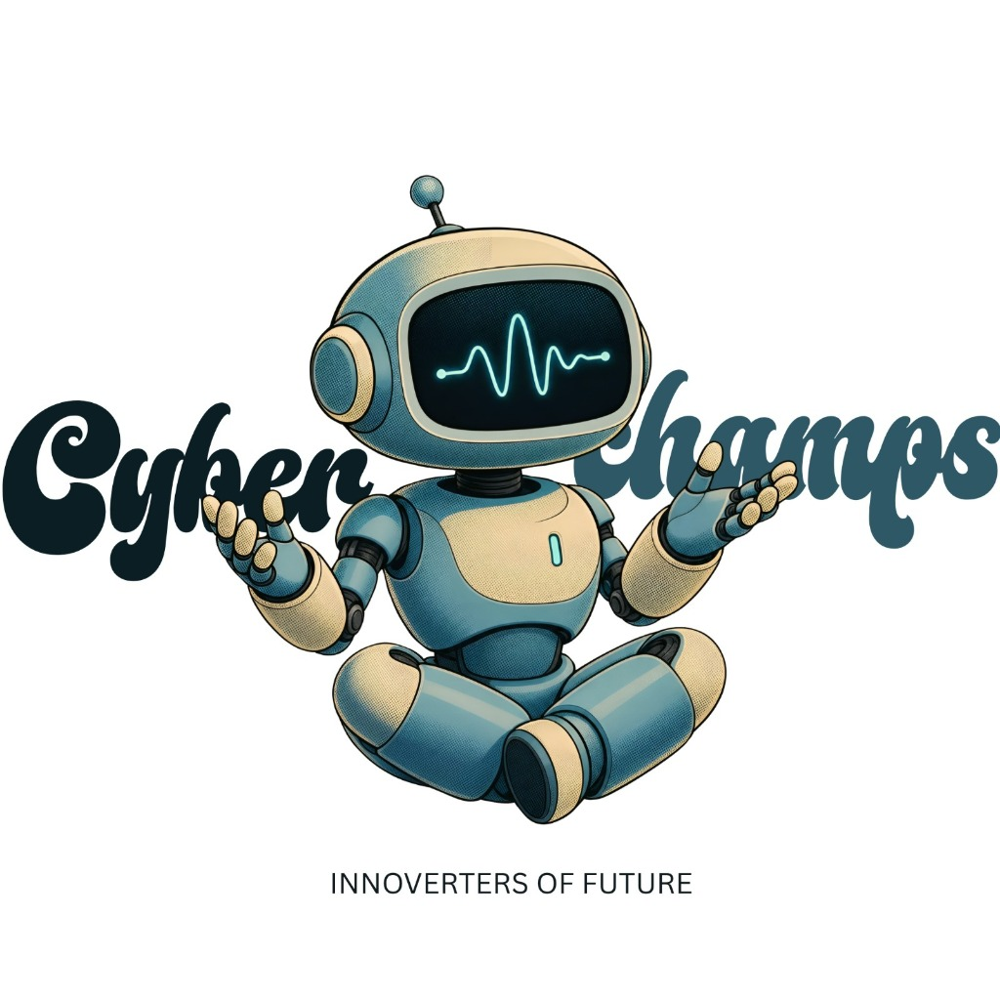

# 🤖 TEAM CYBER CHAMPS (#291) // National Robotics League 2026



> **"Different Roles | One Goal | A Smarter Tomorrow"**  
> *Build · Innovate · Compete — Innoverters of Future*

An ultra-modern, interactive 3D competition showcase and engineering portfolio website for **TEAM CYBER CHAMPS (Team #291)** competing in the **National Robotics League (NRL) HYPERDRIVE 2026 Delhi Regional Championship**.

---

## ⚡ Live Deployments

- **🌐 Live Website (GitHub Pages)**: [https://laptop25112000-dev.github.io/CYBER-CHAMPS/](https://laptop25112000-dev.github.io/CYBER-CHAMPS/)
- **📦 GitHub Repository**: [https://github.com/laptop25112000-dev/CYBER-CHAMPS](https://github.com/laptop25112000-dev/CYBER-CHAMPS)
- **⚡ Vercel Deployment Ready**: Preconfigured with `vercel.json` for zero-config root routing (`/`).

---

## 👥 The Squad · Assigned Competition Roles

Directly mapped from our official NRL Delhi Regional team poster:

| # | Member | Role | Icon | Focus & Arena Responsibilities |
|---|--------|------|------|--------------------------------|
| **01** | **Mayank Prasad** | **TEAM LEAD** | 👑 Crown | Multidisciplinary build coordination, NRL HYPERDRIVE rule compliance, and pit strategy. |
| **02** | **Sayan Kakkar** | **DRIVER** | 🏎️ Steering Wheel | Precision 4WD skid-steer maneuvers, CORE ring collection, and 15-point Space Station dock balance. |
| **03** | **Swastik** | **STRATEGIST** | 💡 Lightbulb | Match gameplans, score optimization algorithms, payload drop timing, and 3D modeling. |
| **04** | **Divyansh Mishra** | **TECHNICAL** | ⚙️ Gear / CPU | Avionics architecture, HEXA Command Hub firmware, wireless 2.4GHz RF telemetry, and OLED diagnostics. |
| **05** | **Chirag Koli** | **MECHANICAL** | 🔧 Wrench | 4mm optical polycarbonate chassis fabrication, 6061-T6 aluminum belly pan, and Rule R1.1 sizing envelope. |
| **06** | **Mahika Singh** | **HUMAN PLAYER** | 👤 Human Silhouette | Safe perimeter ring staging at the Source Zone, queue management, and zero-fault rule adherence. |
| **07** | **Shubh Shankar** | **RESEARCH** | 🔍 Magnifying Glass | Game manual scrutiny, opponent scoring efficiency analysis, and technical dossier verification. |
| **08** | **Samrat** | **HELPING** | 🤝 Handshake | Pit maintenance, rapid 60-second hardware servicing, claw linkage setup, and spare parts readiness. |
| **09** | **Dakshesh** | **SUPPORTING** | 🛡️ Shield | 7.4V Li-Ion battery health diagnostics, pre-match safety audits, and wire strain relief inspection. |

---

## 🎓 Our Mentors

Guided by esteemed faculty advisors from start to competition:

| Mentor | Designation | Guidance Area |
|--------|-------------|---------------|
| **Vipul Gupta Sir** | **MENTOR** — Faculty Mentor & Robotics Lead | Engineering oversight, electrical safety architectures, control theory, and high-stakes tournament tactics. |
| **Iqbal Kaur Mam** | **MENTOR** — STEM & Technical Advisor | Design validation, team coordination, safety compliance, documentation excellence, and state championship presentation. |

---

## 🤖 The Robot · Engineering Specifications

- **Chassis & Envelope**: Dual-deck 4mm optical polycarbonate plates with CNC-machined 6061-T6 aluminum reinforcement, measuring 310mm × 265mm × 195mm (strictly within Rule R1.1 18" envelope bounds).
- **Drivetrain**: 4WD independent skid-steer configuration driven by 4× TT DC high-torque gearmotors (1:48 reduction) with 65mm high-traction knobby rubber wheels.
- **Manipulation Mechanism**: SG90 articulated micro-servo claw with mechanical grabber pads, linked to a gravity-tilt payload cradle with sear-pin trigger for high-pole scoring and vault releases.
- **Avionics & Telemetry**: HEXA dual-core robotics hub, HexaLINK 2.4GHz FHSS wireless link (<4.2ms latency), and onboard 0.96" I2C OLED display outputting live battery voltage, match timer, and Team #291 identity.

---

## 🎨 Interactive Website Features

1. **Official Team Poster Layout**: Interactive replica of our competition poster (4 in Row 1, 4 in Row 2, 1 centered in Row 3) with pastel organic bubble badges, custom SVG iconography, and script typography (`Caveat`).
2. **Deep-Dive Technical Modals**: Click any squad member or mentor to inspect technical competencies, build contributions, tools used, and competition radar stats.
3. **Interactive 3D Rover Viewer**: Real-time WebGL view with exploded components, subsystem inspection, and wireframe overlays.
4. **Interactive 2.5D Driving Simulator**: Keyboard/touch-driven mini-game simulating arena navigation, obstacle avoidance, and ring collection.
5. **Interactive Scrapbook Dossier**: Retro perforated tearable notebook (`/tearable`) with physical drag-to-tear slips, polaroid cards, and field reports.

---

## 🛠️ Tech Stack

- **Framework**: React 19 + Vite
- **3D Graphics & WebGL**: Three.js + Draco GLTF Loader
- **Styling**: Tailwind CSS v4 + Custom Engineering Theme
- **Typography**: Google Fonts (`Geist`, `Inter`, `Caveat`, `Orbitron`)
- **Icons**: Lucide React + Hand-crafted Competition SVGs
- **Audio Synthesizer**: Native Web Audio API (zero external sound dependencies)

---

## 🚀 Getting Started

### Prerequisites
- Node.js (v18+)
- npm

### Installation & Local Development
```bash
# Clone the repository
git clone https://github.com/laptop25112000-dev/CYBER-CHAMPS.git
cd CYBER-CHAMPS

# Install dependencies
npm install

# Start local dev server
npm run dev

# Build for production
npm run build

# Preview build locally
npm run preview
```

### Deployment Configuration
- **GitHub Pages**: Automatically deployed via GitHub Actions on push to `main` with base path `/CYBER-CHAMPS/`.
- **Vercel**: Deploy with zero configuration; `vercel.json` and dynamic `vite.config.js` ensure root `/` path is used automatically.

---

## 📜 Competition Compliance

All rover specifications and team roles strictly adhere to the **National Robotics League (NRL) HYPERDRIVE 2026 Official Game Manual**, including:
- **Rule R1.1**: Sizing Envelope (< 18" × 18" × 18")
- **Rule R1.3**: Exterior Safety & Edge Chamfering
- **Rule R8.7**: Scrutineering Display & Team #291 Signage
- **Rule R9.4**: Mechanism Separation & Payload Handling Safety
